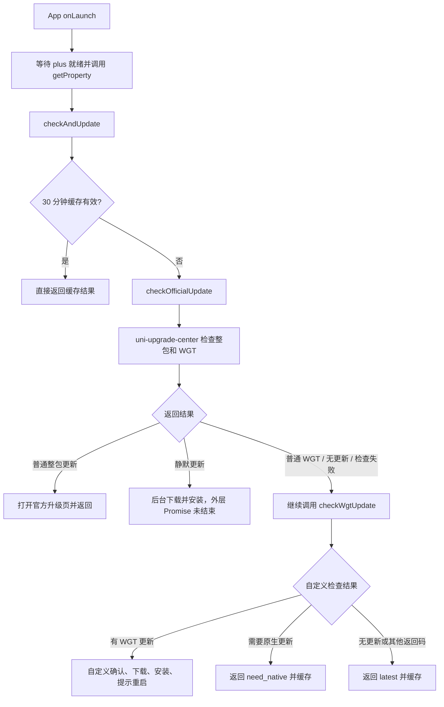
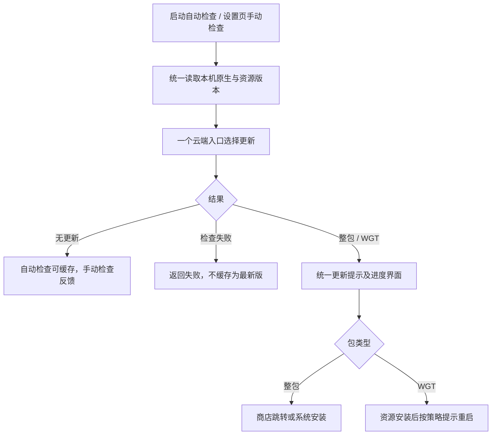

# App 整包更新与热更新梳理及精简方案

更新日期：2026-09-28  
状态：历史评估与问题记录；新实现已完成，迁移尚待正式 APK 发布。

> 2026-09-28 实施更新：客户端已移除升级插件，改用自定义 `checkAppUpdate`、`utils/appUpdate.js` 和更新页面；统一版本名称格式为 `major.minor.patch`。新增云函数已部署，旧接口兼容代码已完成但尚未部署。实际发布流程与当前状态请见 [统一更新与旧版迁移发布说明](../deployment/app-update-migration.md)。下文保留改造前分析，其中复用官方升级页的建议已被自定义页面方案替代。

## 1. 结论

可以精简。当前复杂度主要来自官方升级中心与自定义 WGT 更新流程叠加，以及原生版本、资源版本和整数版本号混用。

建议保留现有升级中心及版本数据表，收敛为：

- 一个客户端检查入口。
- 一个云端版本决策入口。
- 一个更新提示与进度界面。
- 整包、WGT 分别执行必要的安装操作。

优先统一版本含义和兼容性判断，再删除重复流程。旧客户端仍依赖的云函数需要保留兼容，不能随新客户端一起删除。

## 2. 评估范围与限制

本次检查了本地启动入口、客户端更新工具、升级插件、两套云函数、升级页面和设置页，并使用模拟数据执行了部分现有代码。

本次没有修改更新逻辑，没有部署云函数，没有访问线上版本数据库，也没有进行真机更新测试。因此：

- 下文描述的是本地代码行为。
- 线上云函数是否与本地一致、发布记录具体如何填写，尚待核实。
- 模拟复现可以确认分支行为，不能替代下载、安装、重启的真机验收。

## 3. 当前涉及的文件

| 文件 | 当前职责 |
| --- | --- |
| [App.vue](../../App.vue) | App 启动时触发更新检查 |
| [utils/hotUpdate.js](../../utils/hotUpdate.js) | 缓存、串联两套检查、自定义 WGT 弹窗及下载安装 |
| [call-check-version.ts](../../uni_modules/uni-upgrade-center-app/utils/call-check-version.ts) | 获取版本信息，调用官方升级云函数 |
| [check-update.ts](../../uni_modules/uni-upgrade-center-app/utils/check-update.ts) | 处理官方检查结果、静默下载、打开升级页 |
| [upgrade-popup.vue](../../uni_modules/uni-upgrade-center-app/pages/upgrade-popup.vue) | 更新提示、商店跳转、下载进度、安装及重启 |
| [uni-upgrade-center/checkVersion/index.js](../../uniCloud-aliyun/cloudfunctions/uni-upgrade-center/checkVersion/index.js) | 官方升级中心中已定制的版本判断，同时处理整包和 WGT |
| [checkWgtUpdate/index.js](../../uniCloud-aliyun/cloudfunctions/checkWgtUpdate/index.js) | 第二套 WGT 查询及版本判断 |
| [settings.vue](../../pages/settings/settings.vue) | 从 manifest 展示版本，目前没有手动检查更新入口 |

两套云函数均查询 `opendb-app-versions`。这里称为“官方”的模块已经有项目定制，不能等同于未修改的官方实现。

## 4. 当前实际流程

### 4.1 触发与缓存

- 当前业务入口位于 `App.vue` 的 `onLaunch`，仅在 `APP-PLUS` 环境执行。
- 启动调用参数为 `silent: true, showConfirm: true`。
- 没有在设置页提供手动检查，也没有在每次回到前台时重新检查。
- 默认缓存时间为 30 分钟，使用 `lastUpdateCheckTime` 和 `lastUpdateCheckResult`。
- 发现整包或 WGT 更新时提前返回，不缓存该次结果；用户取消 WGT 后，下次启动仍可能提示。
- 缓存未命中且没有整包更新时，通常串行调用两个云函数。

### 4.2 整包更新

1. `call-check-version.ts` 从 `getProperty()` 结果取 `widgetInfo.versionCode`，转换为字符串后作为 `appVersion` 上报。
2. 同时把 `widgetInfo.version` 作为 `wgtVersion` 上报。
3. 服务端按 `appid + platform + stable_publish` 查询，按创建时间倒序选取整包和 WGT 记录。
4. 服务端先比较整包记录的 `version` 与客户端 `appVersion`。
5. 有整包更新时，客户端保存包信息并打开 `upgrade-popup.vue`。
6. 升级页处理应用商店跳转或下载安装，并根据强制更新标记控制关闭、返回等行为。

### 4.3 WGT 热更新

存在两条处理路径：

- 官方云函数也会返回 WGT。客户端对普通 WGT 不打开升级页，而是继续进入自定义检查；对静默更新则直接启动后台下载。
- 自定义 `checkWgtUpdate` 再次查询同一数据表，按 `appid + type=wgt + stable_publish + uni_platform` 过滤，按创建时间取第一条。

自定义路径发现更新后，默认弹出确认，使用 `plus.downloader` 下载，再调用 `plus.runtime.install`；安装完成后弹出不可取消的重启提示。

## 5. 已确认的问题

### 5.1 原生版本来源和比较格式混用

当前整包检查使用 `widgetInfo.versionCode`，这个值来自应用资源信息。原生安装包版本应与资源版本明确区分。

同时，客户端可能上报 `168`，服务端却用同一个分段版本比较函数将其与数据库 `version` 比较。若数据库记录为 `1.6.9`，会判定 `1.6.9 < 168`，从而漏掉更新。

**模拟已复现：** 整包记录为 `1.6.9`，客户端上报 `appVersion=168` 时，现有云函数返回 `code: 0`。

线上是否发生该问题取决于实际发布记录的格式，不能据此断言所有线上整包更新都已失效。

### 5.2 两套 WGT 兼容性判断不一致

官方云函数要求客户端原生版本与查到的整包版本相等，或不存在整包记录，才进入 WGT 判断；但对于 `min_uni_version`，代码明确因格式不匹配而跳过实际校验。

自定义云函数则用 `wgtVersion` 与 `min_uni_version` 比较，没有获取原生安装包版本。

这会产生两种风险：

- 资源版本已经升高，但原生安装包仍旧，可能错误放行需要新原生能力的 WGT。
- 资源版本较低时，可能提示升级原生包，但判断依据并不能证明原生包确实不兼容。

**模拟已复现：** 官方路径会在不满足最低版本要求的示例中返回 WGT；自定义路径可以仅凭较高的资源版本放行更新，无法识别实际原生包是否满足要求。

### 5.3 官方静默分支没有结束 Promise

`check-update.ts` 在 `is_silently` 分支启动下载后直接 `return`，没有调用外层 Promise 的 `resolve` 或 `reject`。

因此 `hotUpdate.js` 中的 `await checkOfficialUpdate()` 会一直等待，后面的自定义检查无法继续。后台下载可能仍会发生；这里悬空的是更新检查流程，不代表整个应用界面被阻塞。

该分支也没有等待安装成功回调，就打印安装完成日志，日志不能作为安装成功证据。

### 5.4 查询失败被标记为最新版并缓存

自定义云函数查询异常时返回 `code: -100, hasUpdate: false`。客户端只单独处理“有更新”和“需要原生更新”，其他结果均进入 `latest` 分支。

**模拟已复现：** `code: -100` 被包装成 `type: latest`，并写入检查缓存。默认会影响后续 30 分钟的检查；如果未来直接增加手动入口，也会面临错误反馈。

### 5.5 静默检查与静默安装含义混杂

| 配置 | 实际含义 |
| --- | --- |
| `silent` | 控制部分检查结果提示，不代表后台安装 |
| `showConfirm` | 控制自定义 WGT 安装前是否询问 |
| `is_silently`，官方路径 | 后台下载并安装，设计意图为下次启动生效 |
| `is_silently`，自定义路径 | 只跳过首次确认，仍显示下载遮罩和重启弹窗 |

同一个后台标记可能因所走路径不同而产生不同体验。

### 5.6 数据选择与平台条件需要统一

- 官方路径按 `platform` 查询，自定义路径按 `uni_platform` 查询。
- 两条路径均依据 `create_date` 选择记录，创建时间最新不一定等于版本最高或当前客户端可安装的最高版本。
- 自定义路径只取一条记录；如果这条记录不兼容，不会再寻找较旧但兼容的更新。
- 官方路径先查询再查找包类型，没有显式分页，不能假设返回结果覆盖全部历史发布记录。

需要核实线上字段的真实含义、平台取值和稳定版发布约定，再确定统一规则。

## 6. 推荐的精简方案

### 6.1 目标流程

### 6.2 统一版本约定

| 概念 | 建议来源 | 用途 |
| --- | --- | --- |
| 原生安装包版本名称 | `plus.runtime.version` | 整包版本比较、WGT 最低原生版本判断 |
| 原生安装包整数版本号 | `plus.runtime.versionCode` | 单独保留原生构建序号，按需要用于发布及比较 |
| 当前资源版本名称 | `plus.runtime.getProperty().version` | 判断 WGT 是否更新 |
| 发布包版本 | 后台版本记录 | 与同一含义、同一格式的客户端版本比较 |

建议在升级中心现有 `version` 为分段版本名称的前提下，原生和资源判断都使用对应的版本名称。整数版本号单独存取，不与版本名称混比，也不要通过拆分数字猜测两者之间的映射。

`min_uni_version` 在本方案中统一表示 WGT 所需的最低原生安装包版本；已有记录是否遵循该约定需要先审计。若原生能力存在不向后兼容的变化，仅有最低版本限制可能不足，需要额外定义兼容范围。

### 6.3 合并云端决策

推荐继续使用 `uni-upgrade-center`，将版本判断统一到一个入口，保留现有后台及数据表。

为减少行为变化，第一阶段保留项目当前“整包优先”的策略：

1. 校验请求参数并统一平台标识。
2. 获取适用平台的有效发布记录。
3. 判断是否存在需要升级的整包。
4. 若无需整包更新，再根据原生兼容条件和资源版本选择 WGT。
5. 明确返回无更新、更新包、需要原生升级但无可用包、检查失败等结果。

决策还需避免整包覆盖后使资源版本意外回退。整包优先不代表可以忽略当前资源版本与目标包内容之间的关系。

新客户端一次检查只发起一次版本请求，不再调用第二套 WGT 检查。

### 6.4 合并客户端执行流程

建议把 `hotUpdate.js` 收敛成薄的更新管理入口，职责限定为：

- 自动检查与手动检查的差异处理。
- 获取版本、发起请求、校验和转换响应。
- 防止检查、下载重复执行。
- 缓存明确成功的无更新结果。
- 将更新包交给统一升级界面。

现有 `upgrade-popup.vue` 已经支持整包和 WGT，优先复用其下载、安装和进度逻辑，再按项目需要调整外观。这样可以删除自定义 WGT 下载器、安装器和重复弹窗。

仍需要保留包类型分支：系统安装包、商店跳转和资源包安装不是同一种操作。

### 6.5 收敛策略与缓存

第一阶段建议保留普通更新和强制更新，暂时停用静默安装。该项属于建议的行为变化，尚未实施，发布时需明确同步后台策略。

- 自动检查：无更新时不打扰用户，失败时记录日志，有更新时显示统一提示。
- 手动检查：绕过检查缓存，明确显示无更新或失败。
- 普通更新：允许稍后处理。
- 强制更新：明确下载失败、安装失败、用户取消系统安装后的行为，不能只靠隐藏取消按钮。
- 缓存只代表某组本机版本最近一次成功检查的结果；版本变化后应失效。
- 如后续确有静默安装需求，再定义下载、安装、下次启动生效及失败重试规则，并保证所有 Promise 都有结束路径。

## 7. 可以精简与需要保留的内容

| 内容 | 建议 |
| --- | --- |
| 同一次检查重复读取版本 | 合并为一次读取并传递结果 |
| 客户端串联两个云函数 | 新客户端改为一次统一检查 |
| 自定义 WGT 下载、安装、弹窗 | 接入统一升级页后移除 |
| 两套版本比较和兼容规则 | 云端统一 |
| 写死在多处的 App ID | 集中配置 |
| 大量重复调试日志、失效注释 | 保留关键版本、决策及失败日志，清理误导信息 |
| 普通与强制更新 | 保留并统一语义 |
| 原生版本与资源版本 | 必须分别保留 |
| Android 安装、iOS 商店、WGT 重启等差异 | 保留必要的平台和包类型处理 |
| 旧客户端依赖的 `checkWgtUpdate` | 迁移期保留兼容 |
| 插件内未被当前入口引用的示例和跨端文件 | 不应仅凭名称删除，先确认引用及支持范围 |

## 8. 实施顺序

### 阶段一：确认线上事实

- 核对已部署云函数与本地差异。
- 抽查实际整包、WGT 发布记录的 `version`、`platform`、`uni_platform`、`min_uni_version`、稳定版标记和下载地址。
- 在安装包更新前后、WGT 更新前后记录原生和资源版本，确认真实设备上的取值。
- 明确当前支持的平台和普通、强制、静默更新的使用情况。

### 阶段二：修正协议与判断

- 统一新客户端的版本来源及格式。
- 修正最低原生版本校验、错误返回和缓存行为。
- 为旧客户端保留兼容响应；必要时通过新 action 或协议标记区分新旧请求。
- 不直接改变旧接口字段含义，让旧客户端承受未经验证的判断变化。

### 阶段三：合并客户端

- 改为一次检查和统一升级界面。
- 删除已被替代的自定义 WGT 执行流程。
- 增加设置页手动检查入口。
- 清理重复配置、日志和失效注释。

### 阶段四：发布验证与退役

- 先部署兼容新旧客户端的服务端，再发布新客户端。
- 观察更新检查、下载安装、重启后的版本数据。
- 保留旧接口服务仍在使用旧版 App 的用户，满足退役条件后再移除。

## 9. 验收要点

| 场景 | 预期 |
| --- | --- |
| 无更新 | 自动检查无提示；手动检查反馈已是最新版本 |
| 有整包更新 | 根据平台进入商店或下载安装流程 |
| 原生兼容且有 WGT 更新 | 允许资源更新，重启后版本与功能正确 |
| 原生不兼容 | 不下发不可安装的 WGT，明确原生升级结果 |
| 原生仍旧、资源版本已较高 | 不能用资源版本冒充原生兼容能力 |
| 查询失败、下载失败、安装失败 | 明确失败状态，不误报最新版或安装成功 |
| 重复触发检查 | 不重复下载、不重复弹窗 |
| 普通更新取消 | 可以继续使用，下次提示策略明确 |
| 强制更新失败或系统安装取消 | 按既定强制策略处理，可重试 |
| 本地版本变化 | 原版本检查缓存失效 |
| 发布记录有多条或新记录不兼容 | 按约定选择有效版本，不只依赖创建时间 |
| 旧客户端访问旧接口 | 保持兼容 |

实施时应为版本选择、错误处理、缓存和异步结束路径补充针对性测试，并进行整包及 WGT 的真机验收。

若修改 `App.vue` 等应用生命周期逻辑，须先阅读 [App 字体模块约定](../app-font-contract.md)，执行 `npm run check:quality` 和 `npm run build:app`；涉及跨端管理器时补充 `npm run build:mp-weixin`。更新流程改造不能破坏汇文明朝的安装包资源路径及按页面注册约定。

## 10. 预期收益

- 缓存未命中的常规检查由两次版本请求收敛为一次。
- 版本判断和兼容规则各维护一套。
- 下载、安装、提示与进度界面统一维护。
- 消除已确认的版本格式误判、最低原生版本校验缺失、Promise 悬空和错误缓存问题。
- 后续发布者能够明确区分更新资源与更新原生能力所需的操作。

## 11. 参考资料

- [DCloud HTML5+ Runtime API](https://www.html5plus.org/doc/zh_cn/runtime.html)：原生安装包版本与 `getProperty` 应用信息的来源。
- [DCloud App 升级中心](https://doc.dcloud.net.cn/uniCloud/upgrade-center.html)：统一整包与 WGT 更新、客户端升级界面及服务端检查流程。

本方案结合本地定制代码提出，不假设当前项目行为与官方默认策略完全一致。
