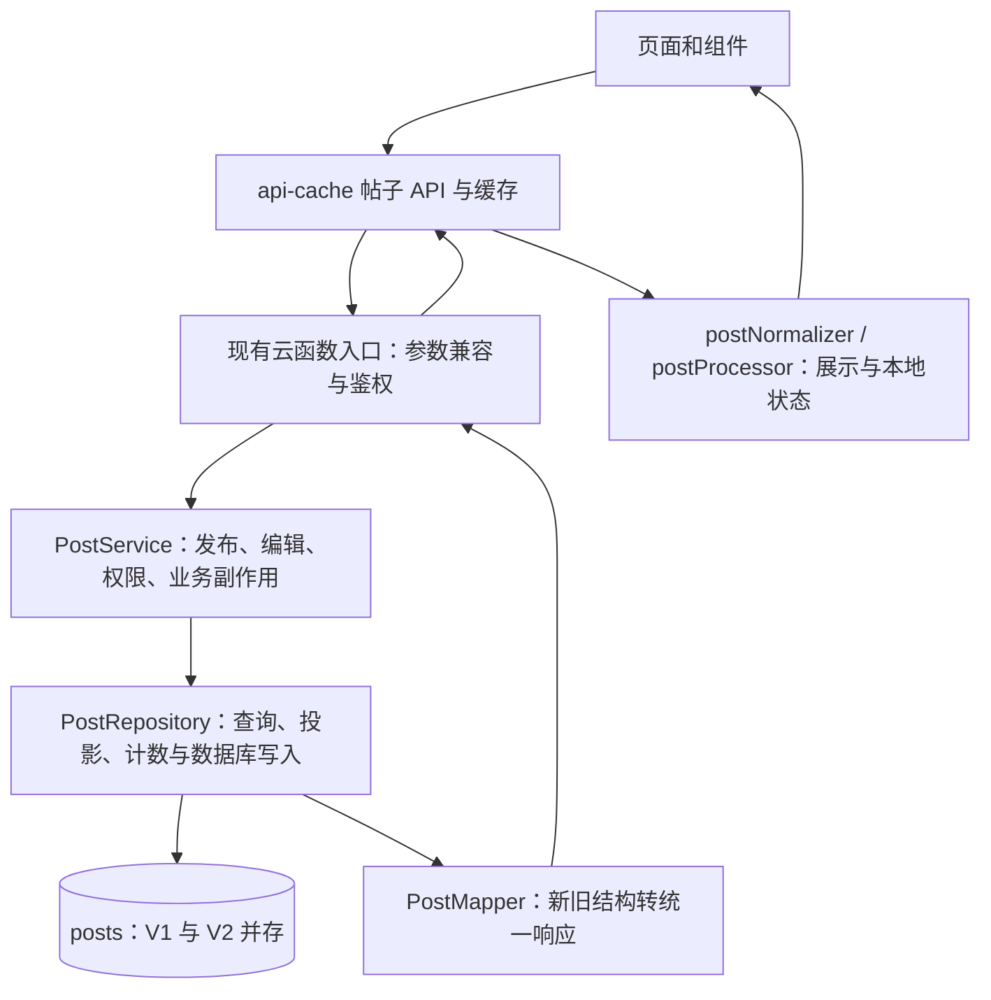

# posts 字段精简与统一访问方案（整包更新）

日期：2026-09-28。状态：已开始按双向兼容方式实施，本地代码与自动验证见 [部署说明](../deployment/posts-v2-rollout.md)。尚未部署云端，精简写入由服务端开关分阶段启用。本文保留原设计与验收目标，实际完成边界以部署说明为准。

依据：当前工作区源码与用户提供的 45 字段样例；未连接生产环境核对数据分布、索引和已部署函数。现有 [初步精简草案](../features/posts-field-slimming-plan.md) 保留，本文件进一步明确目标结构、所有访问入口的改造和上线条件。

## 1. 建议采用的方案

**新发布的帖子统一写精简的 V2 文档；服务端统一查询、校验和生成兼容返回对象；历史帖子继续读取，不先做全库删字段。**

具体决策：

1. 使用 `schemaVersion: 2` 标识新结构。数据库只保存真实业务数据，页面需要的默认值、别名和计算字段在响应中生成。
2. `publishMode` 统一表达普通、诗歌、讨论；停止新写 `isPoem`、`isDiscussion`。组诗和拼贴诗仍各保留一个仅为 true 时存储的标记，避免新增类型枚举改变现有分区语义。
3. 作者显示资料只保留 `authorName`、`authorAvatar` 一套；删除重复快照写入。诗歌署名 `author` 独立保留。
4. 高光只存 `highlightLines`，讨论只存 `sentenceGroups`，图片只存数组；数量、首项、封面别名在读取时生成。
5. 无活动、非匿名、非组诗、无引用、无标签的帖子不写对应空字段。计数为 0、原创为 false 等有明确语义的值不能通用过滤。
6. 各云函数可以保留现有函数名，但必须共用同一套 posts 契约与访问模块。整包发布前先升级服务端读取、查询和兼容入口。

按本方案，用户样例可由 **45 个顶层字段减少到 20 个**，约减少 56% 的字段数量；新发公开帖尚无更新时间和隐藏标记时为 18 个。此数字包括自动生成的 `_id`，并保留真实的审核时间。它不是数据库字节数或费用下降的承诺，正文、图片和组诗内容的大小仍需实际测量。

### 1.1 新旧 App 兼容性与强制更新决策

本方案沿用同一个 posts 集合，“旧数据/新数据”指文档格式不同，不是切换到两个数据库。目标是双向兼容，但不能将下表当作已经通过新旧安装包真机验收的结果。

| 组合 | 按方案实施后的目标 | 必要条件 |
| --- | --- | --- |
| 新 App 读取旧帖子 | 支持 | 服务端保留 V1 查询和字段回退，新 App 消费统一响应 |
| 新 App 读取新帖子 | 支持 | 服务端识别 V2，补齐页面需要的默认值和派生字段 |
| 旧 App 读取旧帖子 | 保持支持 | 保留旧函数名、请求参数、返回外壳与字段语义 |
| 旧 App 读取新帖子 | 可以支持，需按实际安装版本验收 | 旧 App 经过已升级的服务端接口读取；查询兼容 V2，响应仍提供旧客户端所需字段 |

例如 V2 只存 `publishMode: 'poem'` 和 `highlightLines`，旧 App 调用原来的 getPostList/getPostDetail 时，服务端仍返回 `isPoem: true` 和数组首项生成的 `highlightSentence`。这部分兼容字段只存在于响应中，不重新写入数据库。

当前源码的主要帖子入口经过云函数；实现已通过共享数据库访问层转换 getPostList/getDiscussionPosts 等入口的旧查询条件。**线上必须先部署这一兼容层再启用精简写入；只删存储字段、不改服务端，新旧 App 都可能漏查，强制更新 App 不能代替云函数改造。**

因此，不需要仅因字段精简就预先决定强制更新。启用 V2 写入前，使用实际发布过、拟继续支持的旧安装包在测试环境完成阅读验收；发布、编辑、匿名归属和删除需另验，能阅读不代表这些操作自动兼容。当前工作区源码不能替代旧安装包证据。

如果某些旧版本直接读取数据库、依赖无法保留的接口或不安全身份字段，或者发布/编辑协议无法安全适配，则对这些版本设定最低支持版本并安排强制更新。强制更新还需确认旧版本已有可用的强更能力；必要时由服务端执行版本准入，不能只给新 App 加一个强更弹窗就认为旧用户已经被拦截。即使决定强更，服务端仍必须兼容历史帖子。

## 2. 当前实现中必须一起解决的问题

| 现状 | 源码依据 | 对本次改造的影响 |
| --- | --- | --- |
| 主发布仍经过 `contentAudit → contentCheck`，其中直接插入 posts | [api-cache/publish.js](../../api-cache/publish.js)、[contentCheck](../../functions/contentCheck/index.js) | 不能只修改名称更直观的 `createPost` |
| 至少五处独立创建 posts | `contentCheck`、`createPost`、`createDiscussionPost`、`createSeriesFromSingles`、`uploadCollagePoetry` | 所有保留的入口都必须使用同一写入白名单 |
| 主发布初始化所有类型字段，插入后又追加写颜色和高光 | [contentCheck](../../functions/contentCheck/index.js) | 只改首次 add 仍会把已删字段写回来；应一次构造完整文档 |
| 作者显示资料与 snapshot 重复，资料同步也同时改两套字段 | [syncUserPostsMetadata](../../functions/syncUserPostsMetadata/index.js) | 这些 snapshot 当前不是不可变的历史档案，没有必要重复存储 |
| 类型查询散布在列表、管理、推荐、个人页、周刊和网站中 | [getPostList](../../functions/getPostList/index.js)、[adminManager](../../functions/adminManager/index.js)、[webReader](../../回车键新网站/cloudfunctions/webReader/index.js) 等 | 只在返回时补布尔值救不了数据库查询漏项 |
| 编辑会补回类型布尔值、图片别名、组诗计数 | [updatePostContent](../../functions/updatePostContent/index.js) | 必须同步改编辑、管理改类型及后台更新任务 |
| 前端归一化目前主要处理图片、头像和时间 | [postNormalizer.js](../../utils/postNormalizer.js)、[postProcessor.js](../../utils/postProcessor.js) | 不能误认为现有 normalizer 已覆盖新旧数据库结构 |
| 发布重构旧文档与当前主链路不同 | [旧发布文档](../features/post-publishing-refactor.md)、[分类排查记录](../post-publish-classification-review-2026-09-07.md) | 以当前实际调用与部署清单为准，实施时同步修正文档 |

## 3. V2 数据库存储契约

继续使用平铺字段和现有字段名，减少无意义改名及嵌套路径变化。`schemaVersion` 只由服务端写入；没有版本的历史记录按 V1 处理。

### 3.1 基础字段和独立业务字段

| 字段 | V2 规则 | 原因 |
| --- | --- | --- |
| `_id` | 数据库生成，保留 | 帖子及关联记录的标识 |
| `_openid` | 必须；保留现有所有权模型 | 普通帖为账号标识；匿名帖的处理见后文 |
| `schemaVersion` | 必须，值为 2 | 明确区分存储规则，避免靠字段缺失猜版本 |
| `publishMode` | 必须：`normal` / `poem` / `discussion` | 基础类型唯一事实来源 |
| `title`、`content` | 有内容才存；两者允许按业务分别缺失 | 图帖可没有正文；组诗正文见 3.3；响应补空字符串 |
| `createTime` | 必须，由服务端生成 | 排序与发布时间 |
| `updateTime` | 真正修改后写入 | 不在创建时重复写 createTime 的副本；保留现有更新业务语义 |
| `votes`、`commentCount` | 必须，创建为 0 | 维护计数比每次聚合全量关系表便宜，不能作为冗余删除 |
| `auditStatus`、`auditTime` | 状态及对应状态记录时间由服务端生成 | 不把状态与时间相同视为可删依据；不改变当前各端审核策略 |
| `author` | 诗歌有实际署名时保留；其他类型通常不存 | 作品作者可能不是发布账号，不能与 authorName 合并 |
| `authorName`、`authorAvatar` | 非空时保留一套显示资料 | 保持列表读取成本及用户资料缺失时的回退；不再写 Snapshot 副本 |
| `authorSignature` | 非匿名且有签名时保留 | 分享与帖子显示仍有用途；空字符串省略 |
| `backgroundColor`、`textColor` | 保存实际选定的有效配色 | 不从可能变化的全局主题重新推算用户已经选定的颜色 |
| `tags` | 非空数组才存 | 无标签返回 `[]`，不强制落库 |

保留作者资料的一套副本是一项明确取舍：本轮消除重复和空值，不把每个列表变为强依赖实时 users 联表。修改昵称、头像和签名时，继续同步这些单一字段；V1 可暂保留旧同步行为，V2 绝不能补回 snapshot。

`auditTime` 指当前审核状态的记录时间，不宣称一定发生了外部审核。当前源码的跳过审核行为需要如实保留与记录，不能通过字段精简顺带调整。

### 3.2 类型、匿名、可见性和活动

| 字段或字段组 | V2 写入规则 | 读取和查询规则 |
| --- | --- | --- |
| `isPoem`、`isDiscussion` | 停止写入 | 从 publishMode 生成旧接口布尔值；查询必须改为 V1/V2 双分支 |
| `isOriginal` | 仅诗歌必须明确写 true 或 false | 新诗歌缺失该值应拒绝发布，不能静默落入非原创 |
| `isSeries` | 仅组诗写 true | 保留此查询标记，省去对数组长度的类型查询；组诗必须有合法分块 |
| `isFoundPoetry` | 仅拼贴诗写 true | 保留当前拼贴诗子类型；publishMode 仍为 normal |
| `isAnonymous` | 仅匿名写 true | 缺失表示 false，不从 `_openid` 的字符串前缀推断 |
| `anonymousAuthorName` | 停止新写 | 匿名显示名只存 authorName；旧接口需要时生成该别名 |
| `realAuthorOpenid` | 仅匿名帖必存，服务端从已验证身份取得 | 服务端归属、通知、屏蔽使用；公开响应禁止泄露 |
| `isHidden` | 仅隐藏时写 true；取消隐藏删除字段 | 缺失表示公开，但仍须遵守审核、屏蔽和场景权限；用户样例中的 true 必须保留 |
| `isActivityPost` | 停止写入 | V2 用非空 activityId 判断官方活动帖 |
| `activityId`、`activityTitleSnapshot`、`activityPublishTime` | 只在官方活动帖写入有意义的值 | activityId 必须有效；仍强制 normal、非匿名；保留标题快照和活动专用时间 |
| `joinedActivityId`、`joinedActivityTitleSnapshot`、`joinedActivityAt` | 只在参与活动时写入 | 参与活动与官方发布不是同一关系；退出活动移除整组字段 |
| `parentPostId`、`quotedPostId` | 有真实关系才存 | 暂不合并；它们不应仅因常为空就被当作相同语义 |

官方活动与参与活动仍互斥。新协议统一使用 `joinedActivityId`；兼容层将创建接口原有 `joinActivityId` 映射过去，若新旧入参同时出现且冲突，应报错。

匿名帖暂保留现有 `_openid: '123456'` 与 `realAuthorOpenid` 的存储模型，避免本轮同时迁移账号归属。所有权限判断统一调用 `resolveOwner(post)`，不能在编辑和隐藏接口继续只比较 `_openid`。公共数据用字段白名单输出，匿名时强制匿名头像、隐藏签名，并剔除真实身份及能反查身份的引用字段；禁止直接 `...post` 返回。

用户示例的 `_openid: 'anonymous_1762175027048'` 与 `isAnonymous: false` 不冲突：账号身份字符串与匿名发帖是两回事，不应据此前缀改为匿名发布。

### 3.3 内容结构、图片和派生字段

| 当前字段 | V2 决策 |
| --- | --- |
| `highlightLines` / `highlightSentence` | 诗歌有高光时只存 highlightLines；单句由首项派生。保留现有去重、排序及数量限制，不能在精简时改选句结果 |
| `sentenceGroups` / `discussionSentences` | 讨论只存 sentenceGroups；旧结构在读取边界转换。若讨论高光完全来自句组，则响应中提取，不再重复入库 |
| `seriesBlocks` / `seriesBlockCount` | 组诗只存 blocks；数量按长度计算。块内以 subtitle、content、highlightLines、有效配色和图片等实际数据为准，清理重复单句和空值 |
| `seriesCoverImage` / `seriesCoverHighlight` | 当前写法是首块图片和高光的副本，停止新写；按同一公式生成响应。现有非空历史字段作为兼容回退，不批量删除 |
| 组诗顶层 `content` | 本轮保留服务端按 blocks 生成的聚合正文，供搜索、查重、推荐和已有正文消费者使用；它是有意保留的检索副本，不能仅为减少字段而删除 |
| 组诗顶层高光和配色 | 以当前封面选择为准；若独立选择与块内容不同则保留，不能一律改成首块 |
| `imageUrls` / `imageUrl` / `poemBgImage` | 普通图片只存非空 imageUrls；首图别名和“诗歌首图即背景图”在响应生成。历史独立 poemBgImage 与首图不同仍尊重原值 |
| `originalImageUrls` / `originalImageUrl` | 仅原图数组与展示图不同才存 originalImageUrls；相同则省略。两组按顺序对应，不逐项删除占位导致错位；响应补原图回退及单图别名 |
| `quotedPostTitle`、`quotedPostAuthor`、`quotedPostAuthorId` | 专用讨论入口还会写这组字段。本轮保留必要的引用快照，明确引用内容删改后的展示行为后再考虑合并；匿名来源不得写入可公开反查真实身份的信息 |
| `isMergedFrom`、`mergedToSeriesId` | 保留实际合并关系；不因样例没有就遗漏。源诗隐藏、关系回写与组诗创建必须保持一致 |
| `discussionCount`、`viewCount`、`embedding` 等 | 专项业务有使用时保留并纳入服务端写入白名单；不要求每个帖子初始化。是否迁出 embedding 是独立性能议题 |
| 拼贴诗的 `createdAt`、`updatedAt` | 新帖统一 createTime / updateTime；响应兼容历史命名 |
| `isVoted`、`isAuthor`、时间文案、临时图片 URL | 仅响应或客户端状态，禁止写进帖子文档；isVoted 必须按访问者计算 |

“不写空值”由各字段规则实现，不能对任意对象递归删除所有 falsy 值；尤其不能删除 `votes: 0`、`commentCount: 0`、`isOriginal: false`。

### 3.4 用户样例精简后的文档

下面保留示例的业务值，时间使用 ISO 文本便于阅读；真正入库仍使用数据库支持的日期类型。`schemaVersion` 是新增字段，其他保留字段沿用原名称。

```json
{
  "_id": "650815a96ab7c13b010010024b88f630",
  "_openid": "anonymous_1762175027048",
  "schemaVersion": 2,
  "publishMode": "poem",
  "isOriginal": true,
  "title": "跳跳锅庄",
  "content": "我告诉你，有数千只沉重的袖子 就有数千只人 数千只人拿了袖子的钱 帮助袖子按指标飞起来 指标是你、赤松德赞、 乾隆和停滞东方的黑格尔 绕着火焰的是不断 新燃的旧的舞蹈 因此我和赞普可能看过同一支 但他们快乐肯定不及我 因为他们花费雪域的生命 而我可以花费二氧化碳，沥青，棉花和时间",
  "author": "徽某爻",
  "authorName": "徽某爻",
  "authorAvatar": "/static/sticker/poem_wine.png",
  "backgroundColor": "#97D4F1",
  "textColor": "#041A38",
  "highlightLines": [
    "但他们快乐肯定不及我",
    "因为他们花费雪域的生命",
    "而我可以花费二氧化碳，沥青，棉花和时间"
  ],
  "votes": 0,
  "commentCount": 0,
  "auditStatus": "approved",
  "auditTime": "2026-09-26T20:57:31+08:00",
  "createTime": "2026-09-26T20:57:31+08:00",
  "updateTime": "2026-09-26T20:57:37+08:00",
  "isHidden": true
}
```

这只是新存储格式的对照，不代表将这条历史记录实际迁移。

## 4. 统一访问：存储对象与返回对象分开



图中模块均为拟新增或拟调整，不表示当前已经实现。推荐模块职责如下：

| 建议模块 | 单一职责 |
| --- | --- |
| `post-schema` | 版本、字段白名单、类型校验、V1/V2 分类规则、创建与 PATCH 规范化 |
| `post-repository` | 所有 `collection('posts')`、posts 聚合关联、统一筛选及字段投影、原子计数和受控更新 |
| `post-service` | 身份与归属、创建/编辑/隐藏/删除/改类型、活动与组诗等业务校验；复用现有副作用流程 |
| `post-mapper` | 新旧字段回退、派生别名、默认值、公开/本人/管理端响应白名单 |
| 前端 `api-cache` | 统一调用协议、缓存、失效事件；页面不组装数据库查询 |
| 前端 `postNormalizer` / `postProcessor` | 消费统一响应和旧缓存，处理相对时间、图片临时地址、点赞本地状态 |

共享服务端源码建议置于 `functions/_shared/posts/`。云函数是独立部署目录，**不能只写跨目录 require 就假定线上存在共享文件**：新增构建步骤，将共享源码复制到各函数部署产物的 `_lib/posts/`，网站 webReader 的部署包也同步包含它。记录共享模块版本或校验值，部署前检查所有消费者产物一致；生成副本不允许手工维护。

不新增一个每次跨云函数调用的“万能 posts 云函数”，避免为共享代码增加网络跳转。原函数名、返回外壳和旧请求参数可以保留，新旧客户端都经过同一内部规则。

### 4.1 返回对象规则

- V2 数据库不存 isPoem，旧接口依然可返回 `isPoem: true`。停止入库与停止对外返回是两项不同操作，本次优先做前者。
- 对 V2，只从规范字段派生别名；不允许偶然残留的旧字段覆盖新字段。对 V1，昵称回退 `authorName → authorNameSnapshot → 用户资料 → 默认值`，头像对应处理。
- 高光在 V1 读取中支持数组及单句；讨论支持两套句组；图片支持单图及数组。V2 显式清空后不能再被旧别名“恢复”。
- 公开响应只能选择明确允许的字段；内部用于归属和屏蔽的 realAuthorOpenid 不可进入公开响应或公共缓存。本人/管理端也只返回业务必需信息。
- 列表与详情可有不同字段投影，但字段含义相同。组诗列表若只需计数与封面，可以在数据库投影时计算，不能先丢掉 blocks 再误算数量为 0。
- API 返回对象不能作为数据库更新对象整体回写；使用专门的创建与编辑白名单。
- `isVoted`、`isAuthor` 等按访问者变化的状态，缓存键须隔离账号；退出、换号和升级清理相关旧缓存。列表预填详情也必须保持同一响应规范。

### 4.2 新旧查询规则与索引

查询必须在数据库筛选阶段识别 V2；仅在 JS map 中补字段会导致先查不到记录。所有列表、count、搜索、关联、排序和分页使用同一筛选定义。

以诗歌为例，语义为：

```text
共同的可见性、作者、标签和屏蔽条件
AND (
  (schemaVersion = 2 AND publishMode = 'poem')
  OR
  (V1 文档 AND 旧结构被统一分类规则认定为诗歌)
)
```

V1 是无 schemaVersion 或明确为 1 的文档；未知未来版本不应被当作 V1 猜测。V1 分类建议优先识别官方活动，再识别讨论、诗歌/组诗，布尔分类缺失时用合法 publishMode 回退，最后为 normal。这会统一目前各入口对矛盾旧记录的不同解释：实施前输出冲突样本与影响数量，确认后将规则固化为测试，不根据正文猜测原创。

V2 查询的具体口径：

| 场景 | V2 条件或规则 |
| --- | --- |
| 原创/非原创诗歌 | publishMode = poem，并明确匹配 isOriginal true/false |
| 讨论/普通 | publishMode 分别为 discussion/normal；按入口继续处理官方活动及拼贴子类型 |
| 可合成单篇 | poem、非组诗、无 mergedToSeriesId，且属于本人；不只靠“不是组诗”判断 |
| 官方活动流 | 非空且匹配的 activityId；参与流用 joinedActivityId |
| 非匿名/公开帖子 | 缺失标记视为 false；不使用只匹配显式 false 的查询 |
| 我的帖子 | 普通所有权与匿名真实所有权统一；只允许本人查看本人范围 |

V1 分类函数与数据库谓词必须通过相同样例验证一致，不能一个讨论优先、一个诗歌优先。分页、hasMore、总数也必须使用完整条件；不采用“各取一页新旧数据后拼接”的做法。常规时间列表统一稳定排序 `createTime DESC, _id DESC`；推荐等特殊排序保留其规则并补稳定次序。

先根据线上现有索引和实际查询计划拟定索引变更：重点检查版本/类型/原创/时间、作者/时间、官方活动/时间、参与活动/时间及隐藏筛选。V1 索引在历史数据仍使用时保留；V2 索引提前建立并验证双分支 OR 的成本。不能只因源码编译成功就认为线上分页和查询性能已通过。

## 5. 必须纳入改造的入口清单

以下是当前源码发现的主要范围；实施时还要扫描 `from: 'posts'` 聚合关联、变量集合名及管理端通用批量操作，不能只搜索 collection 字面量。

| 分组 | 入口 | 必做事项 |
| --- | --- | --- |
| 主发布与兼容发布 | contentCheck、createPost | 同一构造器与状态规则；移除插入后的重复字段回写；保留各端已有审核流程 |
| 专用发布 | createDiscussionPost、createSeriesFromSingles、uploadCollagePoetry | 讨论、合并组诗、拼贴统一格式；点赞状态不入库；保留关系与统计副作用 |
| 修改与删除 | updatePostContent、updatePostVisibility、deletePost、adminManager | 类型变更、字段清空、所有权、隐藏、批量替换都遵守版本规则 |
| 基础阅读 | getPostList、getPostDetail、getDiscussionPosts、searchPosts、getSearchSuggestions、checkDuplicatePoem、getAllTags | 查询前兼容、字段投影与返回一致 |
| 首页与推荐 | getFollowingPosts、getFollowingUsersWithUpdate、getHotFeed、getPersonalizedFeed、getRecommendationFeed、getPoemContentFeed | 统一类型、作者、可见性及分页；推荐分数仍按原算法计算 |
| 个人与诗人 | getMyProfileData（含 handlers/favorites）、getMyLikedPosts、getUserFavorites、getPoetPosts、getPoetInfo、getPoetList | 匿名归属、聚合关联、显示字段与计数一致；实际无 posts 访问的分支不必硬改 |
| 作品集与组诗 | getPortfolioItems、getOtherPortfolioItems、getUserPortfolio、getPortfolioFolders、listMySingles | 关联读取也用相同 mapper，不让收藏/作品集保留另一套解释 |
| 活动、周刊及拼贴 | getRecentActivities、getWeeklyContent、adminManager 的活动/周刊候选与快照逻辑、getCollagePoetry | 类型过滤、快照生成、活动关联保持一致；已发布周刊快照不是本次清理对象 |
| 互动及维护 | vote、addComment、deleteComment、getComments、likeComment、syncUserPostsMetadata、bindWechatOpenid、backfillPostEmbeddings | 计数、归属、账号迁移和维护任务不能重新注入旧字段 |
| 独立网站 | 回车键新网站/cloudfunctions/webReader | 共用查询与公共输出规则；部署顺序纳入主项目发布清单 |
| 前端 | api-cache 下发布/帖子/诗歌/列表/主页/标签/作品集封装；postNormalizer、postProcessor；发布、详情、管理和分享消费者 | 接口边界归一化、请求显式字段、缓存升级；页面不再各写旧字段回退 |

另需核对云端实际部署函数、定时任务、控制台脚本和小程序数据库直读规则。仓库里的备份、`index_fixed.js` 等不是默认运行入口，但若线上仍部署它们就必须处理。

## 6. 创建、编辑与旧数据的处理约定

### 创建

- 所有入口先适配旧入参，再验证领域数据，最后由同一构造器生成 V2 白名单对象。客户端不能指定归属、计数、审核结果或 schemaVersion。
- 新客户端显式提交发布快照，预览与实际提交消费同一数据源；不通过展开 Vue 页面实例收集字段。
- 兼容旧客户端的字符串布尔值等已知格式。完全没有类型信息时，不凭空猜“原创诗歌”；无法安全识别的发布请求返回可理解的错误并保留草稿。
- 颜色、高光和图片在首次创建时一次写齐。已有的活动计数、引用讨论计数、诗人主页、组诗源帖隐藏等后续操作保持原业务结果；对重试和中途失败安排一致性验收，不能因抽模块而漏掉。

### 编辑与维护

| 入参情形 | 处理方式 |
| --- | --- |
| 字段未出现 | 保留原值，不以默认空值覆盖 |
| 合法非空新值 | 验证后替换允许编辑的字段 |
| 可选数组显式 `[]`、可选文本显式 `''` | 表示清除，生成数据库字段删除操作；同步清理有关旧别名 |
| 不允许为空的字段被清空 | 拒绝，不偷偷补默认值 |
| 模式切换或退出活动 | 先验证目标状态，成组删除已经无效的专属字段 |
| 点赞、评论计数变化 | 受控原子增减，不对读取快照整文档覆盖 |

V2 的 PATCH 始终遵守 V2。V1 本轮优先采用小范围兼容更新，保留原版本，不把只包含部分数据的 PATCH 当作完整迁移。若后续需要“编辑时顺便转 V2”，须先读取完整文档、验证所有关联语义并处理并发；不能仅加一个 schemaVersion 后留下一半旧结构。

资料同步对 V2 只更新 authorName / authorAvatar / 有效签名，明确清空签名时删除字段。读详情时的缺失计数修复也必须走受控 repository，不能回写整个响应。管理端批量替换不能绕过分类及字段白名单。

本次不批量清理历史文档。历史清理如后续开展，应单独制作 dry-run 清单、备份和可恢复迁移脚本；现阶段保留兼容读取即可。

## 7. 整包更新的实施和发布顺序

整包更新不会自动升级云函数，也不能假设所有用户当天安装新版。建议将以下步骤作为同一次发布工作的依赖顺序：

1. **冻结契约与建立样例。** 完成字段清单，准备各类真实脱敏 V1 和精简 V2 测试数据；盘点线上入口、查询索引、缓存以及所有维护写入者。
2. **落地共享模块。** 实现 schema、repository、service、mapper 和部署复制校验。先让所有读取、查询、计数、权限和后台维护入口兼容 V1/V2，创建暂维持旧格式。
3. **部署读取兼容版本。** 包含推荐、管理端、活动、周刊和独立网站。准备 V2 索引，在测试环境验证混合数据；保留这一版作为回滚基线。
4. **改造全部创建与编辑入口。** 发布入口共用 V2 构造器，旧函数名只是适配器；通过服务端可控开关启用精简写入。开关覆盖所有创建入口，不能只作用于新版 App。
5. **发布 App 整包及其他客户端。** 新客户端消费统一响应；对持久化帖子缓存升级命名空间或做定向失效，不清除用户草稿和登录资料。同步发小程序/H5 所需改动。
6. **观察并完成切换。** 检查各入口新增帖字段集合、错分区/漏查、隐藏及匿名权限、编辑后反弹字段、查询耗时、计数和缓存刷新。全部通过后才确认 V2 写入成为默认。

不能出现“先开始删 isPoem，再慢慢改推荐/网站查询”的中间状态。若有访问者尚未兼容，则暂缓停止写相应字段；这只是部署过渡，不是最终 V2 结构。

回滚时关闭精简写入并回到已准备的 V1 写入路径，但**保留读取兼容版本**，继续读取已经产生的 V2 文档。禁止直接回退到只认识旧布尔字段的整套云函数；否则此前成功发布的新帖会消失于旧查询。不要用全库补字段作为紧急回滚的默认动作。

## 8. 验收标准

### 自动验证

新增真正验证行为的 posts 契约测试，并接入质量检查；不删除原测试，不通过放宽断言掩盖退化。

- 字段集合：用户样例对应 V2 为上述 20 字段；普通、诗歌、组诗、讨论、拼贴、匿名、活动各自只写需要的字段。
- 零值与缺失：计数 0、非原创 false 保留；无关字段缺失；显式清除后旧别名不能复活。
- 多入口等价：所有创建入口对相同业务数据产出同一规范；旧客户端调用也不产生重复字段。
- 混合查询：V1/V2 同页出现，类型、标签、作者、活动、屏蔽、隐藏筛选与 count/hasMore 一致；分页无因新旧分支合并造成的重复或漏项。
- 读写隔离：返回的 isVoted、isAuthor、临时 URL、类型别名永远不能进入数据库；公开响应不含匿名真实身份。
- 编辑：未提交字段不丢失，退出活动成组清除，单篇/组诗及管理改类型保持一致，修改用户资料不补回 snapshot。
- 关键结果：图片预览与原图对应，颜色、高光、签名与旧展示一致；收藏、作品集、周刊、推荐、搜索、独立网站均能读新帖。
- 构建部署：部署包包含共享模块；所有消费者版本一致；在真实测试云环境验证缺失字段的查询、删除操作和所需索引，不能仅以数据库 mock 代替。

实施后的必跑检查：`npm run check:quality`、`npm run build:app`、`npm run build:mp-weixin`；如同步修改 H5，再运行 `npm run build:h5`。本次只交付 Markdown，不运行与本次改动无关的应用构建。

### 真机及发布检查

App 新整包、仍受支持的旧 App、小程序分别验证：普通文字/图片、原创与非原创、组诗、讨论、拼贴、匿名、官方活动和参与活动；发布后查看列表、详情、个人页、收藏及分享，再编辑、隐藏、取消隐藏和删除。

至少两个账号交叉检查匿名权限、屏蔽与点赞状态；验证退出重登、旧缓存、草稿恢复、活动结束后只编辑正文、不同入口跳转详情。网站和管理端检查新旧帖子混排及分页。

本轮方案保留配色、图片和高光语义。后续如果修改卡片绘制、字体管理、应用生命周期或字体资源，应先遵守 [字体模块约定](../app-font-contract.md)，并报告真机验收结果；自动测试不代替真机验证。本次没有进行真机验证。

## 9. 完成条件与本轮边界

完成条件是：所有有效发布入口开始生成 V2，所有 posts 访问者按同一契约读取和查询，编辑及维护任务不再补回已停止写入的字段，旧帖子与旧客户端仍能按支持范围工作。

本轮不更换数据库、不重做账号体系、不更改审核政策、不删除历史帖子字段，也不为追求字段数最少而移除有用途的计数、配色、署名、引用快照或组诗检索正文。后续若要进一步去掉作者资料副本、移出向量或清理历史数据，应在这套统一访问边界落地后单独评估。
